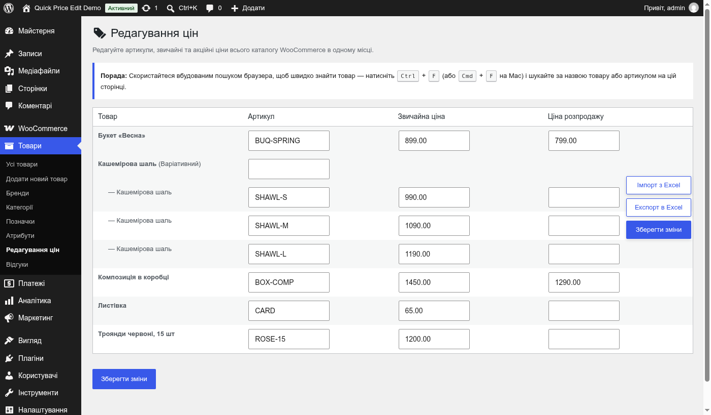

# Quick Price Edit for WooCommerce

Одна сторінка в адмінці WooCommerce, де можна швидко змінити артикули, звичайні й акційні ціни всього каталогу: прості товари й варіації в одній таблиці, експорт та імпорт CSV для Excel.

- Автор: Sasha Zimin · https://zimin.dev
- Версія: **1.9.0**
- Тека плагіна: `wp-content/plugins/quick-price-edit-zimindev`, головний файл `quick-price-edit-zimindev.php`, код у `includes/plugin.php`, текстовий домен `quick-price-edit`, префікс `qpe_`
- WordPress 5.0+ (перевірено на 7.1), PHP 7.4+, WooCommerce (перевірено на 11.2)
- Інтерфейс: English (мова коду), Українська, Русский, Беларуская, Қазақша, Polski, Deutsch, Français — переклади вбудовані в код, без .po/.mo

## Встановлення

1. Завантажте `quick-price-edit-zimindev.zip` (з цього репозиторію або з [Releases](../../releases)).
2. WordPress → «Плагіни» → «Додати новий» → «Завантажити плагін» → вибрати zip → «Встановити» → «Активувати». Потрібен WooCommerce.
3. Сторінка: **Товари → «Редагування цін»**.

### Оновлення з версії до 1.9.0 (тека `quick-price-edit`)

Завантажте й активуйте новий zip. Стара тека `quick-price-edit` вимикається й видаляється автоматично. Плагін не має власних даних — ціни й артикули є звичайними даними товарів WooCommerce, тож нічого не губиться.

## Що вміє

- Таблиця всіх опублікованих простих товарів і варіацій: артикул, звичайна ціна, ціна розпродажу. Варіації показані з атрибутами («Шаль - M»). Пошук — Ctrl+F у браузері.
- Плаваючі кнопки «Імпорт з Excel», «Експорт в Excel», «Зберегти зміни».
- Зберігаються лише змінені поля (великий каталог не впирається в `max_input_vars`); оновлення сторінки після збереження не надсилає форму вдруге.
- Перевірки: ціни ≥ 0, акційна ціна нижча за звичайну, унікальний артикул, права на редагування товару.
- Ціни можна вводити як `12.5`, `12,5` або `1 250,50`.
- **Експорт** — CSV у UTF-8 з BOM (кирилиця в Excel без «кракозябр»), захист від формул у клітинках.
- **Імпорт** — CSV з Excel / LibreOffice / Google Sheets: роздільник `,` `;` або табуляція визначається сам, «CSV» Excel у Windows-1251 перекодовується, колонки знаходяться за назвами будь-якою з 8 мов і в будь-якому порядку. Товар шукається за артикулом, а без нього — за точною назвою (лише якщо вона однозначна). Колонки ціни, якої немає у файлі, не змінюються; порожня клітинка прибирає ціну. Повторний імпорт незміненого файлу нічого не перезаписує.
- Кількість товарів на сторінці — 1000; змінити: `define( 'QPE_PER_PAGE', 200 );` у `wp-config.php`.

## Зміни

**1.9.0** — тека й головний файл `quick-price-edit-zimindev`, автоматичне вимкнення й видалення старої теки `quick-price-edit`; `Update URI`, `Requires Plugins: woocommerce`.

**1.8.0** — дизайн у стилі WordPress, іконка «цінник з олівцем», підпис у футері; сторінка в меню «Товари»; кнопка «Імпорт з Excel» замість панелі імпорту; 8 мов інтерфейсу; ревʼю й оптимізація: на 260 товарах сторінка 751 → 116 запитів до бази, експорт 934 → 74; надійніший імпорт (див. вище).

**1.7.0** — перша версія в репозиторії.

## Ліцензія

GPL-2.0-or-later.
